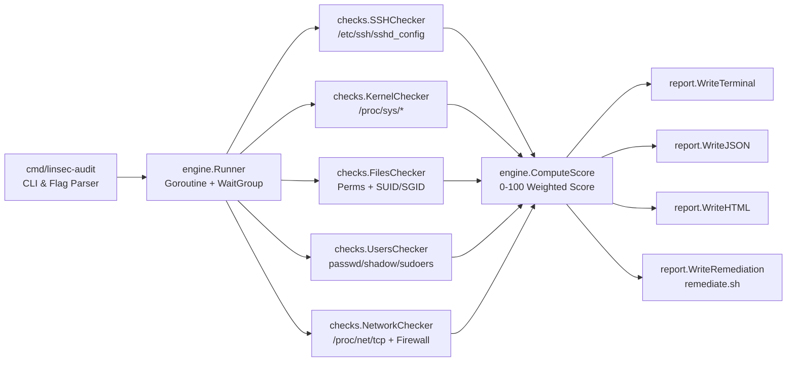

# `linsec-audit` - Linux Security Hardening Auditor

`linsec-audit` is a zero-dependency, **CIS Benchmark-aligned** Linux security hardening auditor written in Go. It evaluates host configuration and runtime kernel state concurrently and can generate a backup-safe Bash remediation script (`remediate.sh`) to fix detected misconfigurations.

Instead of shelling out to external system binaries, `linsec-audit` reads `/proc`, `/etc`, and filesystem metadata directly, keeping its attack surface minimal while completing full system audits in milliseconds.

---

## Key Features

- **Zero External Dependencies:** Built exclusively with the Go standard library (`net`, `os`, `io/fs`, `html/template`, `embed`, `sync`).
- **Concurrent Audit Engine:** Runs security modules in parallel using goroutines and `sync.WaitGroup` with per-module error and panic isolation.
- **CIS Benchmark Alignment:** Every finding includes a unique rule ID (`SSH-001`, `KRN-002`, etc.), CIS Benchmark reference, actual vs. expected state, and a concrete single-line `Remediation` command.
- **Multiple Output Formats:**
  - `term`: ANSI-colored terminal summary with a visual hardening score bar
  - `json`: SIEM / SOAR / CI-CD friendly structured JSON (`schema_version: 1.0`)
  - `html`: Standalone dark-mode HTML dashboard with interactive filtering (`//go:embed`)
- **Backup-Safe Auto-Remediation (`--gen-fix`):** Produces a commented, idempotent `remediate.sh` script that backs up critical configs under `/var/backups/linsec-audit-*` and validates `sshd -t` after applying changes.
- **Cross-Platform Testability:** Configurable `Config.RootDir` and `fs.FS` abstractions enable deterministic unit and integration testing across both Linux and Windows hosts.

---

## Architecture Overview



### Repository Layout

```text
linsec-audit/
├── cmd/linsec-audit/
│   ├── main.go              # CLI flags: scan, --modules, --format, --output, --gen-fix
│   └── main_test.go         # End-to-end CLI integration tests
├── internal/
│   ├── checks/
│   │   ├── interface.go     # Checker interface, Finding, Severity, Config
│   │   ├── ssh.go           # OpenSSH (/etc/ssh/sshd_config & .d/*.conf) checks
│   │   ├── kernel.go        # /proc/sys sysctl hardening checks
│   │   ├── files.go         # Sensitive file permissions and SUID/SGID audit
│   │   ├── stat_linux.go    # Linux syscall.Stat_t UID/GID extractor
│   │   ├── stat_other.go    # Cross-platform build stub
│   │   ├── users.go         # UID 0, empty passwords, sudoers NOPASSWD, login.defs
│   │   └── network.go       # /proc/net/tcp{,6} listening sockets and host firewall
│   ├── engine/
│   │   ├── runner.go        # Concurrent module runner and deterministic sorting
│   │   └── scorer.go        # Weighted 0-100 hardening scoring engine
│   └── report/
│       ├── terminal.go      # ANSI-colored terminal report
│       ├── json.go          # SIEM-compatible JSON output
│       ├── html.go          # go:embed HTML template renderer
│       ├── templates/
│       │   └── report.html  # Standalone dark-mode HTML report
│       └── remediate.go     # Backup-safe remediate.sh generator
├── test/
│   └── Dockerfile.vuln      # Intentionally vulnerable Ubuntu 24.04 demo container
├── Makefile
├── go.mod
└── README.md
```

---

## Installation & Build

```bash
# Install directly with Go
go install github.com/mustafainci067-cell/linsec-audit/cmd/linsec-audit@latest

# Build for local host
make build

# Cross-compile static Linux amd64 binary (CGO_ENABLED=0)
make build-linux

# Run all unit and integration tests
make test

# Run tests with statement coverage breakdown
make test-cover

# Run go vet and gofmt checks
make lint
```

---

## CLI Usage Examples

```bash
# 1. Run all modules and print terminal report
sudo ./bin/linsec-audit scan

# 2. Audit specific modules only (ssh, kernel, users)
sudo ./bin/linsec-audit scan --modules ssh,kernel,users

# 3. Export structured JSON for SIEM/SOAR ingestion
sudo ./bin/linsec-audit scan --format json --output report.json

# 4. Generate standalone dark-mode HTML dashboard
sudo ./bin/linsec-audit scan --format html --output report.html

# 5. Audit, generate remediate.sh, apply fixes, and re-audit
sudo ./bin/linsec-audit scan --gen-fix
sudo bash ./remediate.sh
sudo ./bin/linsec-audit scan

# 6. Audit a mounted rootfs or custom directory
./bin/linsec-audit scan --root /mnt/target-rootfs --no-color
```

---

## Scoring Model

Audits start at **100 points** and deduct points **only for failed (`Passed == false`) findings** according to severity (floored at `0`):

| Severity | Penalty | Example Misconfigurations |
|---|---|---|
| `CRITICAL` | `-15` | `PermitRootLogin yes`, UID 0 backdoor, GTFOBins SUID, world-readable `/etc/shadow` |
| `HIGH` | `-10` | `PasswordAuthentication yes`, `NOPASSWD` sudo, no active firewall, `ip_forward=1` |
| `MEDIUM` | `-5` | `MaxAuthTries > 4`, ICMP redirects enabled, `PASS_MAX_DAYS > 365`, open wildcard ports |
| `LOW` | `-2` | `kptr_restrict = 0`, `PASS_MIN_DAYS < 1` |

| Score Range | Grade | Risk Level |
|---|---|---|
| `90 - 100` | `A` | `LOW` |
| `75 - 89` | `B` | `MODERATE` (70-89) |
| `60 - 74` | `C` | `MODERATE` / `HIGH` |
| `40 - 59` | `D` | `HIGH` |
| `0 - 39` | `F` | `CRITICAL` |

---

## Audit Rules Catalog

| Rule ID | Module | Severity | CIS Ref | Check |
|---|---|---|---|---|
| `SSH-001` | `ssh` | `CRITICAL` | CIS 5.2.8 | `PermitRootLogin no` |
| `SSH-002` | `ssh` | `HIGH` | CIS 5.2.12 | `PasswordAuthentication no` |
| `SSH-003` | `ssh` | `MEDIUM` | CIS 5.2.16 | `MaxAuthTries <= 4` |
| `SSH-004` | `ssh` | `MEDIUM` | CIS 5.2.6 | `X11Forwarding no` |
| `SSH-005` | `ssh` | `CRITICAL` | CIS 5.2.9 | `PermitEmptyPasswords no` |
| `KRN-001` | `kernel` | `CRITICAL` | CIS 1.5.2 | `kernel.randomize_va_space = 2` (Full ASLR) |
| `KRN-002` | `kernel` | `HIGH` | CIS 3.3.8 | `net.ipv4.tcp_syncookies = 1` |
| `KRN-003` | `kernel` | `HIGH` | CIS 3.1.1 | `net.ipv4.ip_forward = 0` |
| `KRN-004` | `kernel` | `MEDIUM` | CIS 3.3.2 | `net.ipv4.conf.all.accept_redirects = 0` |
| `KRN-005` | `kernel` | `MEDIUM` | CIS 3.2.2 | `net.ipv4.conf.all.send_redirects = 0` |
| `KRN-006` | `kernel` | `LOW` | CIS 1.5.1 | `kernel.kptr_restrict` in `{1, 2}` |
| `FIL-001` | `files` | `CRITICAL` | CIS 6.1.3 | `/etc/shadow` mode `<= 0640`, `uid=0` |
| `FIL-002` | `files` | `CRITICAL` | CIS 6.1.1 | `/etc/passwd` mode `<= 0644`, `uid=0` |
| `FIL-003` | `files` | `HIGH` | CIS 5.3.4 | `/etc/sudoers` mode `<= 0440`, `uid=0` |
| `FIL-004` | `files` | `HIGH` | CIS 5.2.1 | `/etc/ssh/sshd_config` mode `<= 0600`, `uid=0` |
| `FIL-005` | `files` | `CRITICAL` | CIS 6.1.13 | Unauthorized or GTFOBins SUID/SGID binary scan |
| `USR-001` | `users` | `CRITICAL` | CIS 6.2.5 | No non-root accounts with UID `0` |
| `USR-002` | `users` | `CRITICAL` | CIS 6.2.1 | No empty-password accounts in `/etc/shadow` or `/etc/passwd` |
| `USR-003` | `users` | `HIGH` | CIS 5.3.5 | No `NOPASSWD` rules in `sudoers` / `sudoers.d` |
| `USR-004` | `users` | `MEDIUM` | CIS 5.5.1.1 | `PASS_MAX_DAYS` between `1` and `365` |
| `USR-005` | `users` | `LOW` | CIS 5.5.1.2 | `PASS_MIN_DAYS >= 1` |
| `NET-001` | `network` | `HIGH` | CIS 2.1 / 3.4 | No risky/cleartext services listening on `0.0.0.0` or `::` |
| `NET-002` | `network` | `MEDIUM` | CIS 3.4.1 | No non-standard wildcard listeners (outside ports 22, 80, 443) |
| `NET-003` | `network` | `HIGH` | CIS 3.5.1 | Active host firewall (`ufw`, `nftables`, or `iptables`) |

---

## Vulnerable Docker Test Lab

[test/Dockerfile.vuln](test/Dockerfile.vuln) builds an intentionally misconfigured Ubuntu 24.04 container with weak SSH settings, permissive file modes (`/etc/shadow` `0644`, `/etc/passwd` `0666`), a SUID `/usr/local/bin/find` binary, a UID 0 `toor` account, an empty-password `guest` account, a `NOPASSWD` sudoers drop-in, and disabled UFW:

```bash
# Build the image and run the 3-stage demo:
# 1) Initial vulnerable scan + --gen-fix (0/100, Grade F)
# 2) Apply bash ./remediate.sh
# 3) Post-remediation re-scan (85/100, Grade B in unprivileged container)
make docker-test
```

For interactive inspection:

```bash
docker build -f test/Dockerfile.vuln -t linsec-audit:vuln .
docker run --rm -it linsec-audit:vuln bash
```

---

## License

This project is licensed under the [MIT License](LICENSE).
